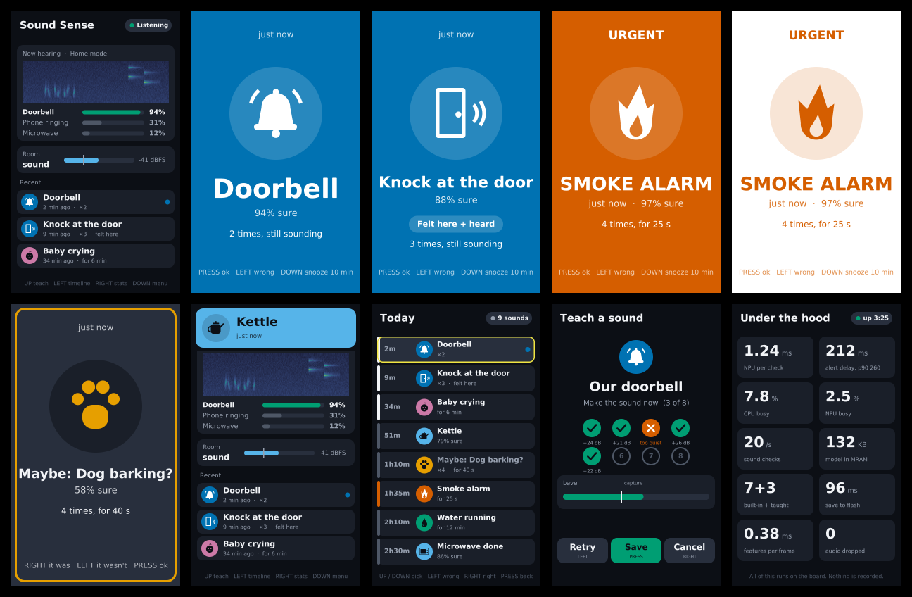

# Sound Sense

**A home sound monitor for deaf and hard-of-hearing people, running entirely on an Alif
Ensemble E8 DevKit (Cortex-M55 + Ethos-U85 NPU).** It recognises the sounds that matter at home,
learns your own sounds from a few examples on the device, tells a knock *on the table it sits on*
from a knock on the TV, and alerts on the screen and LEDs. Audio is never stored and never leaves
the board.

Entry for the [Arm + ExecuTorch Edge AI hackathon](https://arm-executorch.devpost.com/). The model
is a PyTorch audio encoder, quantized to int8 and run through ExecuTorch with every operator
delegated to the Ethos-U85.



## What it does

- **Recognises built-in sounds:** knock, dog, baby crying, alarm, glass breaking, siren, running
  water (plus speech and background, which never alert).
- **Learns your sounds on the device:** press UP, make the sound 5 times, and it builds a profile
  from the encoder's embeddings. Each example is checked (too quiet, clipped) and shown with its dB
  over the room. A test match follows, then save. No retraining, no laptop.
- **Remembers them:** taught sounds are saved in the 64 MB OSPI flash (two copies with CRC32) and
  restored at boot in 2.2 ms. Saving runs in the background without dropping audio.
- **Felt vs heard:** the BMI323 accelerometer, read at 800 Hz, decides whether a knock was felt on
  the table (a real knock at the door) or only heard (probably the TV).
- **Accessible alerts:** full-screen card with icon, word and time; colour-blind-safe palette; an
  LED pattern per sound; three urgency levels, with a 1 Hz strobe for urgent sounds (safe for
  photosensitivity). Low confidence shows as "Maybe: doorbell?", never as a certain alert.
- **Timeline** of today's sounds, with repeats merged and "felt here" marked.
- **Live view:** scrolling spectrogram, room level against its noise floor, and the three best
  matches right now.
- **Stats page,** live from the board: NPU time per run, CPU active %, NPU busy %, save time,
  model size.
- **Boot self-test ("Ready"):** checks both mics, runs the NPU against a reference embedding,
  restores saved sounds, checks the IMU and lights. Ready 1.5 s after reset; any failure stays on
  screen.
- **Power-aware:** the CPU sleeps (WFI) between audio blocks, and the live encoder runs only when
  the room is louder than its noise floor. CPU active 12.6% in a quiet room, NPU idle.

Full feature list with priorities: [docs/SOUND-SENSE.md](docs/SOUND-SENSE.md). What's done and what
isn't: [docs/STATUS.md](docs/STATUS.md) (15 of 16 must-have features done).

## Measured on the board

All numbers from the DK-E8 (M55-HP at 400 MHz, Ethos-U85-256), release build, 2026-10-18.
Details and logs: [docs/GATES-results.md](docs/GATES-results.md).

| What | Result |
|---|---|
| Encoder | 219k parameters, 43.2 M MACs, .pte 240,224 B, **all 14 operators on the Ethos-U85** (0 on the CPU) |
| NPU time per embedding | **1.00 ms** (1.03 ms through the ExecuTorch runner); Vela estimate 0.53 ms at 1 GHz |
| Features (log-mel, 40 bands, every 20 ms) | 0.30 ms per update on the M55 |
| Board vs Python | Features: 0 of 1960 values differ. Embedding within 1 LSB (cosine 0.9996) |
| Few-shot accuracy (offline, 10 classes never trained on) | 5-way 5-shot 75.8% int8 (float 75.9%); 10-way 63.0% |
| Built-in sounds | 88% offline (4% false accepts); 54% live from a laptop speaker (alarm 75%) |
| Taught sounds | Work live; offline 38% accepted, 79% of untaught sounds rejected (borderline, see limits) |
| Knock felt | 21 of 22 at 20 cm; IMU FIFO at 805 samples/s, 0 missed |
| Alert delay | About 0.85 s after the sound starts (decides 0.8 s after the onset) |
| Flash save | 223–266 ms (1,101 saves, 0 audio blocks dropped, 0 failed read-backs); restore 2.2 ms |
| Power | CPU active **12.6%** in a quiet room (was 100%); NPU busy 0.00% when quiet |
| Boot to Ready | 1.5 s |
| Memory | ITCM 97.6% (all hot code), MRAM 1.03 MB of 2 MB (model, fonts, cold code) |

## How it works

```
 PDM mics (16 kHz) ──> log-mel, 40 bands / 20 ms (M55) ──> 49x40 patch (~1 s) ──int8──> encoder (Ethos-U85)
                                                                                           │ 64-d embedding
 onset detector (M55) ── 0.8 s after a sound starts ──> cosine match against profiles <────┘
                                                           │  built-in (9) + taught (up to 8, flash)
 BMI323 IMU, 800 Hz FIFO (I3C) ── knock felt within ±100 ms? ──┤
                                                           v
                                     alert card + LED pattern + timeline  ──>  480x800 MIPI DSI LCD, RGB LEDs
```

**Matching.** Each sound has a profile: the unit-norm mean of its examples' embeddings and a
threshold (the lowest leave-one-out similarity minus 0.05, clamped to 0.5–0.85). A sound at least
8 dB over the room alerts if its best cosine score clears that profile's threshold; within 0.05 of
the threshold it shows as "Maybe: x?". A knock alerts if the encoder hears it or the IMU feels it,
and is certain only when both agree. Teaching is just building a new profile, so it takes
milliseconds on the device.

**Workload placement**

| Work | Runs on | Memory |
|---|---|---|
| Encoder (DS-CNN, int8, all ops delegated) | Ethos-U85-256 via ExecuTorch | weights + command stream in MRAM, arenas in SRAM0/1 |
| PDM capture, log-mel features, onset detection | Cortex-M55 HP | ITCM code, 320 ms audio ring |
| Cosine matching, teaching, alerts, timeline | Cortex-M55 HP | DTCM |
| Knock sensing (BMI323 FIFO over I3C) | Cortex-M55 HP | |
| UI drawing (anti-aliased, SDF fonts, dirty rows) | Cortex-M55 HP | back buffer in SRAM1 |
| Display scan-out | CDC200 + MIPI DSI | frame buffer in SRAM0 |
| Taught sounds (A/B copies, CRC32) | OSPI1 flash, 64 MB | 0x00100000 / 0x00110000 |
| Sleep and NPU gating | WFI between audio blocks; encoder only above floor + 6 dB | |

Unused: the M55-HE core and the two Ethos-U55s (an always-on HE listener is a stretch goal).

## The model

- **Encoder:** a DS-CNN (192 channels, 5 depthwise-separable blocks, 64-d embedding) on the
  49x40 log-mel patch. The features come from the same C code on the board (`firmware/app/kws.c`)
  and in Python (`model/kws_common.py`), and match exactly.
- **Training** (`model/train_ss.py`): a cosine classifier over 76 classes (40 ESC-50 categories,
  35 Speech Commands words, background) for 60 epochs. Only the encoder is kept. 10 ESC-50
  classes are never trained on; they stand in for the sounds users will teach.
- **Evaluation** (`model/eval_ss.py`): few-shot teaching on the held-out classes, rejection of
  untaught sounds, built-in accuracy. Results in `model/out/g1_metrics.json`.
- **Export** (`model/export_ss.py`): PT2E int8 quantization (EthosUQuantizer), EthosUPartitioner,
  Vela for `ethos-u85-256`. Writes `model/ss_encoder.pte`, then `tools/pte2h.py` turns it into
  `firmware/soundsense/assets/ss_model_data.h`. The built-in profiles and a boot test vector come
  out of the same step.

## Repository layout

```
firmware/                 CMSIS csolution, based on alifsemi/alif_vscode-template
  soundsense/             the Sound Sense app
    main.cpp              app logic: screens, teach flow, alerts, self-test, stats, host commands
    ss_audio.c            PDM capture and onset detection
    ss_match.c            cosine matching and profiles
    ss_imu.c              BMI323 FIFO, knock detection
    ss_store.c            taught sounds in the OSPI flash (A/B copies, CRC32, background save)
    ss_board.c, ss_gfx.c  joystick, LEDs, display
    ui/                   screens, icons, LED patterns, SDF fonts (also builds on a laptop)
    assets/               model, built-in profiles, boot test vector
  app/kws.c               log-mel features, shared with Python
  mnist_executorch/       the ExecuTorch runner (executorch_runner.cpp), shared
  imu_bench/ recorder/    gate test firmware (IMU rate, audio recordings)
  hw_test/ flash_test/ psram_test/ npu_draw/ ...   board bring-up demos (see below)
model/                    train_ss.py, eval_ss.py, export_ss.py, ss_common.py; the shipped encoder
tools/                    build, flash, logs, J-Link control, test players, UI simulator
docs/                     spec, status, gate results, demo run sheet, handoffs, bring-up notes
```

## Build and run

Prerequisites (macOS shown; Linux works too):

- Alif DK-E8 on the **PRG USB** port
- [CMSIS-Toolbox 2.15 + Arm GNU 13.3.1](https://github.com/alifsemi/alif_vscode-template)
- [Alif SETOOLS 1.112](https://alifsemi.com/support/kits/ensemble-e8devkit/), serial port set in `isp_config_data.cfg` (A0 boards: see the [bring-up notes](docs/bringup-notes.md))
- SEGGER J-Link (the on-board J-Link OB) for logs and host control

```bash
tools/fetch_et_bundle.sh                         # once: prebuilt ExecuTorch runtime for Cortex-M55 / Ethos-U
tools/build_flash.sh soundsense release          # build and flash to MRAM (about 45 s)
tools/build_flash.sh soundsense release noflash  # build only
tools/rtt_log.sh                                 # follow the board's log into docs/gates/ss_rtt.log
make -C tools/ui_sim                             # render every screen to tools/ui_sim/out/*.png
```

`build_flash.sh` finds SETOOLS and the toolchain through `ALIF_SETOOLS` and `CMSIS_TOOLS`. Set
those if your paths differ. Exact tool versions and a second-machine setup:
[docs/HANDOFF.md](docs/HANDOFF.md).

**Using it:** the joystick does everything. UP teaches a sound, LEFT shows the timeline, RIGHT the
stats, press is OK or dismiss. The demo run sheet, with laptop-played sounds for a repeatable
demo, is [docs/DEMO.md](docs/DEMO.md).

**Host control over J-Link** (scripted tests, no joystick):
`tools/jlink.py <elf> set ss_arg N` then `tools/jlink.py <elf> set ss_cmd C`, where C is 1 teach
preset N, 2 save, 3 home, 4 forget taught sounds, 5 stats, 6 timeline, 7 set clock, 8 press keys,
9 re-measure built-in N, 10 finish, 11 N flash saves, 12 fill the flash record with stand-ins.
`tools/jlink.py <elf> reset` resets the board without halting.

**Python tools** need numpy, scipy and Pillow (`python3 -m venv .venv && .venv/bin/pip install
numpy scipy pillow`). Training and export need torch and ExecuTorch (`model/requirements.txt`) and
the datasets (ESC-50, Speech Commands), which aren't in git.

## Known limits

- **Built-ins through a laptop speaker are weaker** (54% live, 88% offline): the speaker and an
  unfamiliar room change the sound. Teaching your own sounds is the strong path.
- **Taught-sound acceptance is borderline offline at 5 examples** (38%); 8 examples per sound is
  the planned fix.
- **Knocks are felt within about 20 cm** of the board on our table, hence "place me on the table
  by the door".
- **Alert delay is about 0.85 s** against a 0.5 s target: the board waits for the whole sound.
- Not built yet: repeating urgent alerts, night mode, fixing mistakes from the timeline, managing
  individual sounds. See [docs/STATUS.md](docs/STATUS.md).

## Board bring-up (done before the project was chosen)

| Area | Result | Demo |
|---|---|---|
| Build, flash (SETOOLS), RTT logging | working | `blinky`, `hello_rtt` |
| MIPI DSI display, 480x800 | working | `lcd_image` |
| ExecuTorch on the Ethos-U85 (MNIST) | 304 µs per inference, int8 output matches the host | `mnist_executorch`, `npu_display` |
| Touch drawing -> NPU digit recognition | working | `npu_draw` |
| Joystick, pot, BMI323 IMU, PDM mics, touch | pass the self-test | `hw_test` |
| RGB LEDs | red, green, blue, white and 2/4/8 Hz blinks confirmed by eye | `imu_bench` (C3) |
| OSPI flash, 64 MB | erase/program/verify, XIP reads at 74 MB/s | `flash_test` |
| OSPI PSRAM, 64 MB | full pattern test, 107 MB/s read, 113 MB/s write | `psram_test` |
| Camera (MIPI CSI-2) | no camera module in our kit | `cam_test` |

Board gotchas and their fixes: [docs/bringup-notes.md](docs/bringup-notes.md).

## Credits and licenses

- `firmware/` builds on [alifsemi/alif_vscode-template](https://github.com/alifsemi/alif_vscode-template) (Alif license, `firmware/License.txt`) and SEGGER RTT (`firmware/libs/SEGGER_RTT_V796h/LICENSE.md`).
- The ExecuTorch runner started from Arm's [alif-ethos-u85-npu-mnist](https://github.com/arm-education/alif-ethos-u85-npu-mnist) learning path; `tools/fetch_et_bundle.sh` downloads its prebuilt runtime.
- Training data: [ESC-50](https://github.com/karolpiczak/ESC-50) (K. J. Piczak, CC BY-NC 3.0) and [Speech Commands v2](https://arxiv.org/abs/1804.03209) (Google, CC BY 4.0).
- UI fonts: DejaVu Sans (`firmware/soundsense/ui/LICENSE-DejaVu.txt`).
